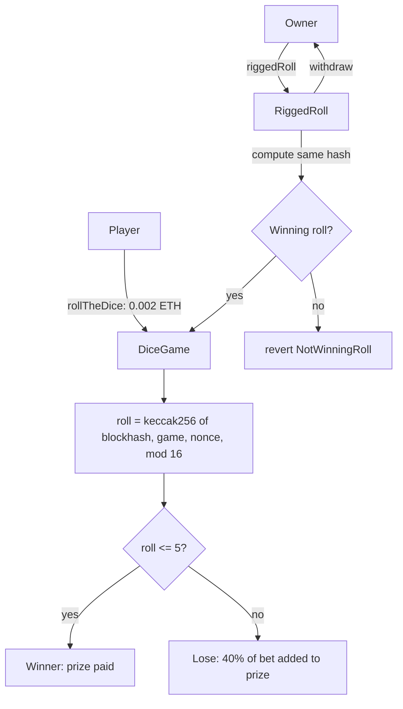

# Dice Game

A dice game with predictable randomness, plus a RiggedRoll contract that only rolls when it will win.

- **Live demo:** https://dice4random.vercel.app/
- **Contract (Sepolia):** [0xF3F83c743EABdff5f6781f3Af1cbD4Ed35273B6C](https://sepolia.etherscan.io/address/0xF3F83c743EABdff5f6781f3Af1cbD4Ed35273B6C)
- **Stack:** Scaffold-ETH 2, Foundry, Next.js, wagmi/viem

## Tech and flow

- **Solidity + OpenZeppelin** (`Ownable`): `DiceGame` rolls `keccak256(blockhash, address, nonce) % 16`. A roll of 0 to 5 wins the prize.
- **RiggedRoll**: computes the same hash first and only calls `rollTheDice` when the result wins. The game's randomness is predictable on-chain.
- **Foundry**: build, test, deploy to Sepolia.
- **Next.js + wagmi/viem + RainbowKit**: roll, view prize and events.

Part of [SpeedRunEthereum](https://speedrunethereum.com).
