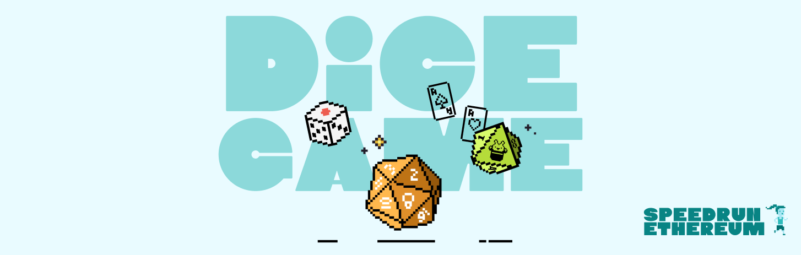

# Dice Game

A dice game with predictable randomness, plus a RiggedRoll contract that only rolls when it will win.

- **Live demo:** https://dice4random.vercel.app/
- **Contract (Sepolia):** [0xF3F83c743EABdff5f6781f3Af1cbD4Ed35273B6C](https://sepolia.etherscan.io/address/0xF3F83c743EABdff5f6781f3Af1cbD4Ed35273B6C)
- **Stack:** Scaffold-ETH 2, Foundry, Next.js, wagmi/viem

Part of [SpeedRunEthereum](https://speedrunethereum.com).
